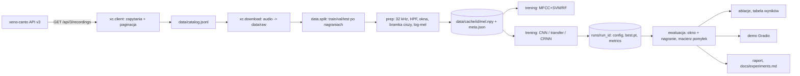

# data-flow.md — przepływ danych

Diagram źródłowy: `SPEC.md` §5. Ten plik opisuje stan faktyczny katalogów i artefaktów.

## Katalogi

| Ścieżka | Zawartość | W repo? |
|---|---|---|
| `data/catalog.jsonl` | metadane nagrań, jeden JSON na nagranie (SPEC §7.1) | nie |
| `data/raw/<id>.<ext>` | pobrane audio | nie (licencje) |
| `data/splits.json` | zamrożony podział train/val/test (SPEC §7.2) | nie |
| `data/cache/<id>/` | `mel.npy` + `meta.json`, odtwarzalne z `data/raw` (SPEC §7.4) | nie |
| `runs/<run_id>/` | config, `env.txt`, `metrics.json`, `best.pt` (SPEC §7.3) | nie |
| `runs/index.csv` | jedna linia na run, źródło tabeli wyników | nie |
| `docs/` | dokumentacja projektu i dziennik | **tak** |

## Zasady

- Sieć istnieje wyłącznie w `xc/` (etap 2). `prep`, `models`, `train`, `eval`, `demo` nie robią
  żadnych żądań HTTP — dlatego testy są offline, a wyniki odtwarzalne z cache'u.
- `data/cache` można skasować w każdej chwili; nie jest źródłem prawdy.
- `splits.json` zmienia się tylko z `--force` i wpisem w dzienniku (SPEC §15.3).
