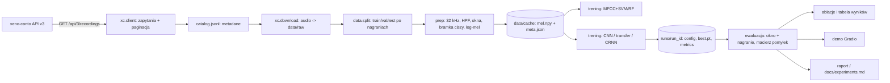

# SPEC.md — bird_recognizer

> Wersja 1.3 · 2026-11-20 · Dokument dla agenta AI, który implementuje aplikację. Język kodu, komentarzy i commitów: **angielski**. README, komunikaty CLI, raporty, komentarze AI: **polski**.
> Nazwa kanoniczna projektu: **`bird_recognizer`** (katalog repo, pakiet Pythona `bird_recognizer`, komenda `bird_recognizer`). Dokumenty projektu leżą w `project info/` — ten plik to `project info/SPEC.md`, plan etapów: `project info/PLAN.md`, reguły pracy: `project info/AGENTS.md`. Kod aplikacji powstaje w katalogu głównym repo. Repozytorium: `https://github.com/DomDom2005/bird_recognizer` — **`TODO(verify)`**: potwierdzić nazwę repo i branch (`main`) u człowieka, zanim wklei się to do README.

---

## 0. Zasady pracy agenta (przeczytaj najpierw)

1. **Dokumentacja xeno-canto wygrywa z tym plikiem.** Przed każdą zmianą w module `xc/` sprawdź https://xeno-canto.org/explore/api. Jeśli dokumentacja przeczy SPEC-owi, wygrywa dokumentacja. Rozbieżność zapisz w sekcji „Odstępstwa od SPEC” w `docs/ai-journal.md` i popraw SPEC.
2. **Niczego nie zgaduj.** Sekcja 4 rozdziela fakty zweryfikowane od rzeczy „DO ZWERYFIKOWANIA”. Nie wymyślaj nazw pól, parametrów zapytań ani liczb (w tym: liczby gatunków w BirdNET, limitów API, wersji bibliotek). Brak weryfikacji → `TODO(verify)` w kodzie i wpis w README.
3. **Nie masz dostępu do klucza API ani do nagrań, dopóki człowiek ich nie dostarczy.** Cała ścieżka kodu musi działać offline: testy na mockach i na krótkich WAV-ach generowanych w `tests/support.py` (`tmp_dir`), bez sieci. Kroki wymagające konta xeno-canto wykonuje człowiek (sekcja 16).
4. **Żadnych sekretów w repo, logach, testach ani przykładach.** Klucz API xeno-canto jest **osobisty i odwoływalny** — wyciek kończy się unieważnieniem klucza. Szczegóły w sekcji 13.
5. **Pracuj etapami i tylko etapami** (sekcja 15). Nie zaczynaj etapu, którego poprzednik nie ma `[x]` w tabeli 15.1. Po każdym etapie: bramka zielona, `ruff check`, `pytest`, commit, wpis w `docs/ai-journal.md` i zmieniony wiersz w tabeli 15.1 — w tym samym commicie.
6. **Dziennik AI (`docs/ai-journal.md`) prowadź uczciwie i na bieżąco.** Zapisuj, w czym pomogłeś i gdzie się pomyliłeś lub musiałeś zmienić założenie. Niczego nie upiększaj ani nie dopisuj na zapas.
7. **Tylko oficjalne API i tylko pobieranie plików, do których wolno cię linkuje API.** Nie ma scrapingu HTML, nie ma obchodzenia limitów (rotacja kluczy, równoległe obejścia), nie ma masowego pobierania „na zapas”.
8. **Jedna zmiana na jeden eksperyment.** Wynik bez zapisanego configu, seeda i commita nie istnieje (sekcja 11).

---

## 1. Cel i kontekst

**Pytanie badawcze (rdzeń projektu):** ile daje modelowanie czasu, czyli CRNN (CNN → BiGRU/LSTM po osi czasu) w porównaniu z modelem, który patrzy na mel-spektrogram okna **bez rekurencji** — przy tym samym zbiorze, tym samym podziale i tych samych augmentacjach?

**Produkt:** pipeline badawczy w Pythonie, który pobiera nagrania z xeno-canto, tnie je na okna, cache'uje spektrogramy, trenuje cztery rodziny modeli (klasyczny MFCC + SVM/RF, mały CNN, CNN z transferem wiedzy, CRNN), ewaluuje je na zbiorze testowym i na własnych nagraniach z telefonu, robi ablacje jednoczynnikowe i wystawia demo (wgraj plik → top-3 gatunki).

**Kontekst:** projekt zaliczeniowy na studiach AI, wątek „sekwencje”. Wynikiem jest **tabela ablacji i raport**, nie aplikacja produkcyjna. Dlatego ważniejsze od SOTA jest to, żeby każdy wynik dał się odtworzyć i obronić.

**Zakres gatunków:** polskie ptaki śpiewające, 12 gatunków, w tym pary trudne do rozróżnienia (decyzja D1).

---

## 2. Zakres

**MVP (etapy 1–8, „wersja minimalna” z `PLAN.md`):**

- katalog nagrań z API xeno-canto v3 (metadane, filtr kraju i jakości),
- pobieranie audio z wznawianiem i raportem błędów,
- podział train/val/test **według nagrań** z kontrolą wycieku,
- preprocessing: 32 kHz, mono, filtr górnopassowy, okna 3 s z nakładaniem, bramkowanie ciszy, log-mel 128 pasm, cache na dysku,
- baseline: MFCC + statystyki → SVM/RF; baseline: mały CNN (bez rekurencji),
- modele główne: ResNet18/EfficientNet-B0 z transferem; CRNN (CNN + BiGRU + pooling mean/attention),
- trening z ważeniem klas, augmentacjami i wczesnym zatrzymaniem,
- ewaluacja: macro-F1, top-3, macierz pomyłek, agregacja okien do nagrania, osobno zbiór własny,
- ablacje jednoczynnikowe i wspólna tabela wyników,
- demo Gradio (plik → top-3 + spektrogram),
- README, dziennik AI, notatki o API, raport.

**Rozszerzenia (po MVP, tylko jeśli czas pozwoli):**

- embeddingi z gotowego modelu (BirdNET / Perch / PANNs) + własna głowica czasowa (GRU lub mały Transformer) — decyzja D12,
- klasyfikacja wieloetykietowa (kilka gatunków naraz),
- lokalizacja w czasie (kiedy w nagraniu śpiewa który gatunek),
- więcej gatunków (do 15) i drugi kraj (`area:europe`).

**Poza zakresem:** aplikacja mobilna, klasyfikacja w czasie rzeczywistym ze strumienia, trening na pełnym BirdCLEF, generowanie dźwięku, własna implementacja backendu webowego, wieloużytkownikowość, publikacja zbioru nagrań.

---

## 3. Założenia i decyzje otwarte

Agent przyjmuje wartości domyślne, dopóki właściciel ich nie zmieni. Każda zmiana decyzji = wpis w `docs/ai-journal.md`.

|ID|Decyzja|Domyślnie|
|---|---|---|
|D1|Lista gatunków|**12 gatunków** w `configs/species.yaml`: wróbel (*Passer domesticus*), mazurek (*Passer montanus*), bogatka (*Parus major*), modra (*Cyanistes caeruleus*), kos (*Turdus merula*), kwiczoł (*Turdus philomelos*), rudzik (*Erithacus rubecula*), zięba (*Fringilla coelebs*), szczygieł (*Carduelis carduelis*), dzwoniec (*Chloris chloris*), pierwiosnek (*Phylloscopus collybita*), piecuszek (*Phylloscopus trochilus*). Cztery pary mylące się: wróbel/mazurek, bogatka/modra, kos/kwiczoł, pierwiosnek/piecuszek. Model nie może odróżniać pary po metadanych — tylko po dźwięku. Lista jest konfiguracją, nie stałą w kodzie; zmiana wymaga zgody człowieka|
|D2|Metryki|**macro-F1 na poziomie nagrania** = metryka główna; dodatkowo top-1 i top-3 accuracy na poziomie nagrania oraz na poziomie okna, macierz pomyłek, per-class precision/recall/F1. Zawsze raportuj `n` i liczbę klas|
|D3|Podział danych|Według **nagrania** (nigdy według okna), **grupami po nagrywającym** (ten sam `rec` nie może wystąpić w dwóch podziałach), stratyfikacja po gatunku, seed 42, stosunek 70/15/15 z minimum 3 nagraniami na gatunek w teście|
|D4|Framework|PyTorch + torchaudio (ścieżka główna). `librosa` tylko w skryptach eksploracyjnych — nie w ścieżce treningowej|
|D5|Okno|**3 s** domyślnie, hop **1,5 s**; okna 5 s i 10 s tylko jako warianty ablacji|
|D6|Próbkowanie i filtr|32 kHz, mono, filtr górnopassowy Butterwortha rząd 4, 100 Hz (usuwa szum wiatru i łoskot)|
|D7|Spektrogram|log-mel, 128 pasm, `n_fft=1024`, `win_length=1024`, `hop_length=512`, `fmin=150`, `fmax=15000`, normalizacja per okno (mean/std)|
|D8|Śledzenie eksperymentów|**Lokalnie i w repo**: `runs/<run_id>/` + `runs/index.csv` + generowana tabela w `docs/experiments.md`. W&B opcjonalne i za flagą `WANDB_MODE=offline`|
|D9|Demo|**Gradio**, lokalny serwer, CPU wystarcza, bez `--share` domyślnie|
|D10|Python|3.11+ (3.12 zalecane)|
|D11|Sprzęt|Musi działać na CPU w trybie `--smoke` (minuty, nie godziny). GPU (Colab/Kaggle) tylko do pełnych ablacji|
|D12|Embeddingi BirdNET/Perch/PANNs|**Opcjonalne**, dopiero po weryfikacji dostępności i licencji wagi. Nie blokują MVP|
|D13|Interfejs|CLI (`argparse`/`typer`) + config YAML. Bez aplikacji webowej poza demem|

**Uwaga o D1:** pary mylące dobrano celowo — mają być ciekawe w macierzy pomyłek. Jeśli po pobraniu katalogu okaże się, że dla któregoś gatunku jest mniej niż 50 nagrań spełniających filtr, **nie zmieniaj progu po cichu** — zgłoś to człowiekowi (sekcja 16) i zapisz w README.

---

## 4. Fakty o API xeno-canto

### 4.1 Zweryfikowane (stan na 2026-11-02, https://xeno-canto.org/explore/api)

- Endpoint: `https://xeno-canto.org/api/3/recordings`. Metoda `GET`, odpowiedź JSON.
- **Parametry zapytania — dokładnie cztery:** `query` (wymagany, niepusty), `key` (wymagany, niepusty — klucz API v3), `per_page` (opcjonalny, `50..500`, domyślnie `100`), `page` (opcjonalny, `1..numPages`).
- **Klucz API jest obowiązkowy w v3.** Klucz ma każdy zarejestrowany i zweryfikowany mailowo członek xeno-canto (strona konta). Dokumentacja zaleca **klucz dedykowany aplikacji**, zabrania publikowania go w repo i ostrzega, że nadużywanie API grozi ostrzeżeniem i **unieważnieniem klucza**.
- `query` to **wyłącznie tagi wyszukiwania** (styl v2 „gołe nazwy gatunków” jest wyłączony i zwraca błąd). Tagi wielowyrazowe oraz zawierające operatory (`=`, `<`, `>`) **muszą być w cudzysłowie**: `sp:"Parus major"`, `q:">C"`. Separator tagów w URL to `+` (spacja).
- Przydatne tagi (z dokumentacji): `sp:`, `gen:`, `ssp:`, `fam:`, `en:`, `grp:`, `cnt:`, `loc:`, `area:`, `lat:`, `lon:`, `box:`, `year:`, `month:`, `since:`, `type:`, `sex:`, `stage:`, `q:`, `len:`, `smp:`, `status:`.
- **Jakość:** tag `q` to skala A–E; `q:A` = tylko A, `q:">C"` = A i B (tak opisuje to przykład w dokumentacji). PLAN mówi „jakość np. A/B” → `q:">C"`.
- **Status identyfikacji:** dokumentacja podaje tag `status` (`identified`, `unidentified`, `questioned`, `unconfirmed`, dodany 2026-07-17), ale **żywe API odrzuca go HTTP 400** — sprawdzone 2026-11-02, `docs/api-notes.md` §3.1. Dlatego tag jest **domyślnie wyłączony** (`api.status: ""`), a brak filtra identyfikacji jest jawnym ograniczeniem danych (§17).
- Odpowiedź: `numRecordings`, `numSpecies`, `page`, `numPages`, `recordings[]`.
- Obiekt nagrania zawiera m.in.: `id`, `gen`, `sp`, `ssp`, `grp`, `en`, `rec` (nagrywający), `cnt` (kraj), `loc`, `lat`, `lon`, `alt`, `type`, `sex`, `stage`, `status`, `date`, `time`, `uploaded`, `length` (łańcuch, np. `"4:08"`), `smp`, `q`, `lic` (URL licencji), `rmk`, `also` (tablica gatunków w tle), `animal-seen`, `playback-used`, `dvc`, `mic`, `url` (strona nagrania), `file` (URL pliku audio), `file-name`, `sono{}`, `osci{}`.
- **Gatunki chronione:** dla nich odpowiedź jest redagowana i zawiera `_meta.redacted_fields` (m.in. `file`, `loc`, `lat`, `lon`). Takie nagrania **nie mają pliku** — trzeba je pominąć, a nie traktować jako błąd pobierania.
- Błędy: HTTP `400`/`500`. Dokumentacja pokazuje `{"error": {"code": "...", "message": "..."}}`, ale **żywe API zwraca płasko** `{"error": "client_error", "message": "..."}` (2026-11-02). Parser obsługuje oba kształty.
- **Limity:** dokumentacja mówi wprost, że „strict rate limit” zostało zniesione (to była bolączka v2), ale nie podaje liczby. Nasza polityka: **jeden request na sekundę** przy paginacji metadanych, pobieranie audio **sekwencyjnie** z pauzą 0,5–1 s, `429`/`503` obsłużone backoffem (sekcja 9).
- Licencje nagrań: pole `lic` wskazuje licencję Creative Commons (np. CC BY-NC-SA 4.0). Nagrania są własnością nagrywającego; sonogramy — fundacji xeno-canto.

### 4.2 Konsekwencje prawne i etyczne (obowiązujące w tym repo)

- Nagrań **nie wolno commitować** ani rozpowszechniać — licencje są różne, część zabrania użycia komercyjnego, część modyfikacji. Repo zawiera **kod, metadane i wyniki**, nie audio.
- W README, w raporcie i w demie podawaj atrybucję: gatunek, nagrywający (`rec`), numer XC (`id`), licencja (`lic`) i link (`url`) — przynajmniej dla zbioru testowego i dla nagrań użytych w przykładach.
- Klucz API jest w URL-u zapytania. **Nie loguj pełnych URL-i** — filtr redakcji musi maskować `key=...` (sekcja 13).

### 4.3 Weryfikacja — wynik 2026-11-02 (`scripts/probe_api.py --live`)

| # | Pytanie | Wynik | Status |
|---|---|---|---|
| 1 | Postać tagu kraju | `cnt:poland` działa: `cnt:poland grp:birds` → 25 129 nagrań | `ZWERYFIKOWANE` |
| 2 | Czy pobranie `file` wymaga klucza | HEAD bez klucza → HTTP 200, `Content-Type: audio/wav` (bywa inne niż mp3 — rozszerzenie z `file-name`) | `ZWERYFIKOWANE` |
| 3 | Format `length` | `m:ss`, 50/50 wartości w próbce (np. `"2:16"`); parser odporny, loguje nietypowe | `ZWERYFIKOWANE` |
| 4 | Czy `q:">C"` zwraca A i B | działa; dla wróbla 119 nagrań (vs. brak taga `q` — porównanie w `docs/api-notes.md`) | `ZWERYFIKOWANE` |
| 5 | Dostępność gatunków z D1 | 81–606 nagrań na gatunek; minimum to szczygieł (81), wszystkie > 50 → D1 wykonalne bez luzowania filtra | `ZWERYFIKOWANE` |
| 6 | `page` poza `1..numPages` | HTTP 400 `client_error` (nie pusta lista) — traktuj jako błąd parametru, nie koniec danych | `ZWERYFIKOWANE` |
| 7 | Dostępność i licencja wag BirdNET / Perch / PANNs | nie sprawdzane — potrzebne tylko, jeśli D12 wejdzie w grę | `TODO(verify)` |

Rozbieżność wykryta przy weryfikacji: tag `status:identified` z dokumentacji jest **odrzucany przez
API** (HTTP 400) — patrz §4.1 i `docs/api-notes.md` §3.1. Tag domyślnie wyłączony; skutek: brak
filtra identyfikacji, szum etykiet widoczny w analizie błędów (`also`, `rmk`).

Liczby z tej weryfikacji są snapshotem z 2026-11-02 — przed etapem 2 powtórz zapytanie i zapisz
świeże wartości w `docs/api-notes.md`, bo katalog rośnie.

---

## 5. Architektura



Zasada: **sieć istnieje tylko w `xc/`**. `prep`, `models`, `train`, `eval`, `demo`, `report` nie robią żadnych żądań HTTP — dlatego da się je testować offline i odtwarzać wyniki z cache'u.

### Struktura repo

```
bird_recognizer/
├── project info/              # dokumenty projektu (nie przenosimy ich do roota)
│   ├── SPEC.md                # ten plik
│   ├── PLAN.md                # plan etapów z bramkami
│   └── AGENTS.md              # reguły pracy
├── AGENTS.md                  # cienki wskaźnik do project info/AGENTS.md
├── README.md                  # po polsku (sekcja 14)
├── requirements.txt           # wersje przypięte po pierwszej udanej instalacji
├── requirements-dev.txt       # pytest, pytest-cov, ruff, freezegun
├── pyproject.toml             # layout src/, konfiguracja pytest i ruff
├── .env.example               # same nazwy zmiennych, żadnych wartości
├── .gitignore                 # .env, data/, runs/, *.wav, *.mp3, *.npy, *.pt
├── configs/
│   ├── default.yaml           # wszystkie progi i hiperparametry (sekcja 10)
│   └── species.yaml           # D1: gatunki, nazwy polskie, łacińskie, para myląca
├── src/bird_recognizer/
│   ├── config.py              # ładowanie i walidacja YAML + env
│   ├── errors.py              # ConfigError, ApiError, AuthError, RateLimitError, DataError, ModelError
│   ├── logging_setup.py       # logi + filtr redakcji (key=, tokeny)
│   ├── models_registry.py     # nazwa modelu → klasa + fabryka z configu
│   ├── xc/
│   │   ├── client.py          # XCClient: query, paginacja, retry, mapowanie błędów
│   │   ├── catalog.py         # budowa i scalanie catalog.jsonl
│   │   └── download.py        # pobieranie audio, wznawianie, hash, raport
│   ├── data/
│   │   ├── audio.py           # odczyt, resample, mono, HPF
│   │   ├── spectrogram.py     # mel-spektrogram, normalizacja
│   │   ├── windows.py         # cięcie na okna, bramkowanie ciszy
│   │   ├── splits.py          # podział i kontrole wycieku
│   │   └── dataset.py         # Dataset z cache'u (okna, etykiety, grupy)
│   ├── models/
│   │   ├── mfcc_baseline.py   # SVM / Random Forest
│   │   ├── cnn.py             # mały CNN bez rekurencji
│   │   ├── transfer.py        # ResNet18 / EfficientNet-B0
│   │   └── crnn.py            # CNN + BiGRU + pooling mean/attention
│   ├── train/
│   │   ├── augment.py         # przesunięcie, szum, mixup, SpecAugment
│   │   ├── loop.py            # pętla treningu, walidacja, early stopping
│   │   └── runner.py          # run_id, seed, snapshot configu, zapis metryk
│   ├── eval/
│   │   ├── metrics.py         # macro-F1, top-k, per-class, macierz pomyłek
│   │   ├── aggregate.py       # okna → nagranie (mean, vote)
│   │   ├── error_analysis.py  # najczęstsze pomyłki + metadane
│   │   └── report.py          # tabele Markdown/CSV do docs/
│   ├── ablation.py            # macierze ablacji jednoczynnikowych
│   ├── demo.py                # Gradio
│   └── cli.py
├── scripts/
│   ├── probe_api.py           # weryfikacja punktów z 4.3 (jeden request)
│   └── check_leakage.py       # kontrola podziału i duplikatów (FR-3)
├── tests/
│   ├── conftest.py            # blokada gniazd, tmp katalogi danych
│   └── fixtures/              # JSON z API (bez prawdziwych danych wrażliwych)
└── docs/
    ├── api-notes.md           # zweryfikowane fakty o API (SPEC §4)
    ├── ai-journal.md          # dziennik AI
    ├── data-flow.md           # diagram z tej sekcji
    ├── experiments.md         # tabela wyników (generowana)
    └── manual-checklist.md    # kroki dla człowieka
```

Katalogi poza repo (gitignore): `data/` (`raw/`, `cache/`, `own/`, `catalog.jsonl`, `splits.json`) oraz `runs/`.

---

## 6. Wymagania funkcjonalne

**FR-1 Katalog nagrań.** `data catalog` dla każdego gatunku z `configs/species.yaml` buduje zapytanie złożone z tagów: `sp:"<nazwa łacińska>"`, `cnt:<kraj>`, `q:">C"` (+ opcjonalnie `type:song` i `status:<wartość>`, jeśli odpowiednie pole configu jest niepuste; tag `status` jest domyślnie **wyłączony**, bo API go odrzuca — §4.1) i pobiera **wszystkie strony**. Wynik: `data/catalog.jsonl`, jeden JSON na nagranie, scalanie po `id` (idempotentne), pole `fetched_at` (UTC ISO 8601). Zapisz też `data/catalog.meta.json`: użyte zapytania, datę, `numRecordings` z API, liczbę zapisanych rekordów. Zapisywanie musi być odporne na przerwanie (dopisuj i rotuj plik `.tmp` → `os.replace`).

**FR-2 Pobieranie audio.** `data download` pobiera pliki z `file` do `data/raw/<id>.<ext>` (rozszerzenie z `file-name`, a gdy go brak — z `Content-Type`; **nie zakładaj `mp3`**, bo API potrafi zwrócić `audio/wav`), sekwencyjnie, z pauzą. Pomiń nagrania z `_meta.redacted_fields.file`. Wznawianie: istniejący plik niepusty → pomiń, chyba że `--force`. Po pobraniu policz `sha256` i zapisz `data/download_report.json` (sukcesy, pominięte, błędy z kodem). `--retry-failed` ponawia tylko błędy z raportu. Duplikaty tego samego pliku (ten sam hash) zgłoś jako podejrzane — mogą być duplikatem nagrania.

**FR-3 Podział danych.** `data split` tworzy `data/splits.json` (schemat w sekcji 7) o zasadach z D3. Wymagania twarde:

- żadne nagranie nie występuje w dwóch podziałach,
- żaden `rec` (nagrywający) nie występuje w dwóch podziałach,
- żaden hash pliku nie występuje w dwóch podziałach,
- stratyfikacja po gatunku; jeśli gatunek nie osiąga minimum 3 nagrań w teście, **ostrzeż i zapisz to** w `data/splits.warnings.json` (nie zmieniaj progu bez decyzji człowieka),
- `--force` nadpisuje plik; bez tego istniejący podział jest zachowany (żeby nie zmienić wyników w trakcie pracy).

`scripts/check_leakage.py --data-dir PATH` ponownie sprawdza wszystkie trzy warunki i kończy się kodem ≠ 0 przy naruszeniu. Uruchamiane przed każdym treningiem i w bramce etapu 2.

**FR-4 Preprocessing i cache.** `prep cache` dla każdego nagrania: odczyt (soundfile/ffmpeg przez torchaudio), mono, resample do 32 kHz, filtr górnopassowy, cięcie na okna (3 s, hop 1,5 s), bramkowanie ciszy, mel-spektrogram, normalizacja per okno, zapis `data/cache/<id>/mel.npy` (float16, kształt `(n_okien, 128, T)`) + `meta.json` (`id`, `sr`, `window`, `hop`, `n_fft`, `hop_length`, `n_mels`, `fmin`, `fmax`, `starts_s[]`, `rms[]`, `kept[]`, `sha256_audio`, `config_hash`). Okna odrzucone trafiają do `kept=false`, nie znikają z pliku — analiza błędów musi widzieć, ile danych odpadło. `--verify` sprawdza `config_hash` i kształty; `--force` przelicza.

**FR-5 Baseline klasyczny.** `train mfcc-svm`: cechy z okna = 40 MFCC (`n_mels=40`, reszta jak D7) + mean i std po czasie → wektor 80-wymiarowy (opcjonalnie `--deltas`). Klasyfikator: SVM (RBF, `class_weight="balanced"`) lub Random Forest (`--clf rf`). Skaluj cechy (`StandardScaler`) dopasowanym **na trainie**. Zapisz model (`joblib`), konfigurację i metryki w `runs/`. Baseline ma być tani: musi się zmieścić w kilku minutach na CPU.

**FR-6 Baseline CNN.** `train cnn`: mały CNN (4 bloki konwolucyjne 32/64/128/256, BN, ReLU, max-pool 2×2), global average pooling, dropout, softmax. Predykcja nagrania = **średnia prawdopodobieństw po oknach**. Brak jakiegokolwiek komponentu czasowego — to jest „model bez RNN” z pytania badawczego.

**FR-7 CRNN.** `train crnn`: ten sam backbone co FR-6 → BiGRU (hidden 128, 1 warstwa, dropout 0,3) po osi czasu → pooling `mean` albo `attention` (konfigurowalne). Okno 3 s ma ~188 ramek mel (hop 512 przy 32 kHz) — to sekwencja, więc rekurencja ma sens. Obsłuż **zmienną długość T** (krótsze ostatnie okno): maskowanie w loss i w poolingu; test regresyjny na dwóch długościach.

**FR-8 Transfer wiedzy.** `train transfer --arch {resnet18,efficientnet_b0} [--pretrained|--scratch]`: wagi ImageNet (pobierane raz, cache w `~/.cache/torch`), 1-kanałowy mel replikowany do 3 kanałów albo pierwsza konwolucja z 1 kanałem (zapisz wybór w configu), nowa głowica `n_classes`. Flaga `--scratch` daje ten sam model bez wag — to wariant ablacji „uczenie od zera vs wstępnie wytrenowane”.

**FR-9 Trening.** Wszystko z `configs/default.yaml` (bez hardkodowania w kodzie). Obowiązkowe: ważenie klas (`class_weight=balanced`) albo oversampling — wybór jest w configu i w metrykach runu; wczesne zatrzymanie po val macro-F1; zapis najlepszego checkpointu; pełny snapshot konfiguracji, `git_sha`, wersji bibliotek, seeda i urządzenia w `runs/<run_id>/`. Jedna komenda = jeden run = jeden katalog.

**FR-10 Ewaluacja.** `eval --run RUN --split {val,test,own}`: metryki na poziomie okna i nagrania; agregacja `mean` (główna) i `vote` (raportowana obok); dla `--split own` osobna tabela „spadek jakości względem testu” (różnica macro-F1). Zapisz `metrics.json`, `per_class.csv`, `confusion_matrix.csv` i PNG.

**FR-11 Ablacje.** `ablate --group {rnn,window,aug,pretrained,pool}`: macierz runów, w której **zmienia się dokładnie jeden parametr** względem runu referencyjnego. Każdy wariant dziedziczy seed, split i resztę configu; zapisz `runs/ablation_<group>.json` z listą run_id i różnicą configu. Wynik: tabela w `docs/experiments.md`.

**FR-12 Analiza błędów.** `error-analysis --run RUN`: 10 najczęstszych par (prawda → predykcja), per-gatunek recall, lista nagrań z największą stratą; do każdego wpisu dołącz metadane z katalogu (`q`, `type`, `also` ≠ puste, `rmk`, liczba okien, udział okien odrzuconych). Wyeksportuj Markdown + CSV.

**FR-13 Demo.** `demo --run RUN`: Gradio; wgraj plik (wav/mp3/ogg/flac) → top-3 gatunki z prawdopodobieństwami, wykres spektrogramu z zaznaczonymi oknami, informacja o modelu i o tym, że wynik jest eksperymentalny. Działa na CPU, bez sieci. Brak checkpointu → czytelny błąd, nie traceback.

**FR-14 Raport.** `report --runs ... --out docs/experiments.md`: generuje tabelę wyników (model, okno, augmentacje, pretrained, pooling, macro-F1 nagranie, top-3, różnica względem referencji), sekcję „wnioski” wypełnianą ręcznie przez człowieka, listę runów z seedami.

**FR-15 Tryb offline.** Testy nie potrzebują sieci ani prawdziwych nagrań: `tests/support.py` generuje deterministyczne WAV-y (krótkie tony/szumy) w `tmp_dir`, a pipeline jest sprawdzany na nich end-to-end. `--smoke` w etapach 4–6 korzysta z **realnego** katalogu z limitem nagrań na gatunek (`--limit`), nie z osobnego zbioru syntetycznego — nie ma więc katalogu `data/synthetic/` ani prefiksu `synth-`.

**FR-16 Weryfikacja API.** `scripts/probe_api.py` ma dwa tryby: `--dry-run` (waliduje config i wypisuje złożone query, **żadnego requestu**) i `--live` (jedno zapytanie na punkt z sekcji 4.3, `per_page=50`, bez pobierania audio), który wypisuje ustalenia do przepisania w `docs/api-notes.md`. `--live` wymaga klucza i kończy się czytelnym komunikatem, jeśli go brakuje — `--dry-run` działa bez klucza i bez sieci, więc może być używany w testach i w bramce etapu 1.

### Wymagania niefunkcjonalne

- **NFR-1** Testy działają offline i deterministycznie; próba otwarcia gniazda w teście ma zawieść (`conftest.py`).
- **NFR-2** Powtarzalność: seed ustawiany w jednym miejscu (python/numpy/torch/cuda); to, co niedeterministyczne na GPU, jest opisane w README, nie udawane jako deterministyczne.
- **NFR-3** Zero sekretów w repo, logach i przykładach; filtr redakcji maskuje `key=`, tokeny i ścieżki do kluczy.
- **NFR-4** `ruff check` bez błędów, `from __future__ import annotations`, adnotacje typów w funkcjach publicznych.
- **NFR-5** Konfiguracja przekazywana jawnie (dataclass `Config`), bez globalnego stanu; każdy run ma pełny snapshot configu.
- **NFR-6** Każda komenda ma tryb `--smoke` (2 nagrania na gatunek, 1 epoka), który kończy się w kilka minut na CPU.
- **NFR-7** Ścieżki (`data`, `runs`, cache modeli) konfigurowalne; dane i wyniki poza repo.
- **NFR-8** Kody wyjścia: `0` sukces, `1` błąd użytkownika/konfiguracji, `2` błąd API/klucza, `3` błąd danych/audio, `4` błąd treningu/modelu (w tym OOM).

---

## 7. Dane i artefakty

### 7.1 `data/catalog.jsonl` — jeden rekord na nagranie

|Pole|Typ|Źródło / uwagi|
|---|---|---|
|`id`|str|`id` z API, klucz główny|
|`species_latin`|str|`gen` + `" "` + `sp`|
|`species_pl`|str|mapowanie z `configs/species.yaml` (nie z API — API daje `en`)|
|`species_en`|str|`en`|
|`group`|str|`grp`|
|`rec`|str|nagrywający (klucz grupowania w podziale)|
|`cnt`|str|kraj|
|`loc`|str|`TODO(verify)`: może być zredagowane dla gatunków chronionych|
|`lat`,`lon`|float \| null|jak wyżej (mogą być zredagowane)|
|`date`,`time`,`uploaded`|str|YYYY-MM-DD / HH:MM / YYYY-MM-DD|
|`length`|str|surowy łańcuch z API (`"4:08"`), parsowany defensywnie|
|`type`|str|song / call / free text|
|`sex`,`stage`|str \| null|mogą być puste|
|`q`|str|jakość A–E|
|`status`|str|identyfikacja|
|`lic`|str|URL licencji|
|`file`|str \| null|URL audio; `null` gdy zredagowane|
|`file_name`|str|`file-name`|
|`smp`|str|sample rate z metadanych|
|`also`|list[str]|gatunki w tle (do analizy błędów)|
|`rmk`|str|uwagi nagrywającego (szum, deszcz — do analizy błędów)|
|`redacted`|bool|`_meta.redacted_fields` obecne|
|`sha256_audio`|str|wypełniane przez `data download`|
|`fetched_at`|str|UTC ISO 8601|

### 7.2 `data/splits.json`

```json
{
  "version": 1,
  "seed": 42,
  "created_at": "2026-11-02T20:00:00+00:00",
  "strategy": {"by": "recording", "group": "recordist", "stratify": "species"},
  "splits": {"train": ["XC123456", "XC123457"], "val": [], "test": []},
  "counts": {
    "train": {"recordings": 700, "species": 12, "windows": 21000},
    "val":   {"recordings": 150, "species": 12, "windows": 4500},
    "test":  {"recordings": 150, "species": 12, "windows": 4500}
  },
  "warnings": []
}
```

### 7.3 `runs/<run_id>/`

`run_id = {YYYYmmdd-HHMMSS}-{model}-{tag}-s{seed}` (np. `20261102-201500-crnn-attn-s42`). Zawartość: `config.yaml` (pełny snapshot), `env.txt` (`git_sha`, wersje torch/numpy, urządzenie), `metrics.jsonl` (jedna linia na epokę), `metrics.json` (wynik końcowy), `best.pt`, `confusion_matrix.{csv,png}`, `per_class.csv`, `log.txt`.

`runs/index.csv` — jedna linia na run, kolumny z sekcji 11.2. Ten plik jest źródłem tabeli w `docs/experiments.md`.

### 7.4 `data/cache/<id>/`

`mel.npy` (float16, `(n_kept, 128, 188)`), `meta.json` (geometria, `rms` **wszystkich** okien, `kept`, `valid_frames`, `config_hash`, `sha256_audio`, `created_at`). Zmierzone 2026-11-20: **~1,5 MB na minutę audio** (521 okien × 48 KB = 24 MB dla 15,8 min) → dla pełnego zbioru (~3738 min) rząd **5,6 GB**. Cache jest w pełni odtwarzalny z `data/raw` — nigdy nie jest źródłem prawdy.

---

## 8. Interfejs CLI

```
bird_recognizer data catalog  [--species NAME ...] [--refresh] [--country poland]
bird_recognizer data download [--species NAME ...] [--limit N] [--retry-failed] [--force]
bird_recognizer data split    [--seed 42] [--force]
bird_recognizer prep cache    [--species NAME ...] [--limit N] [--force] [--verify]
bird_recognizer train mfcc    [--clf {svm,rf}] [--deltas]
bird_recognizer train cnn     [--window 3] [--aug basic|full|none]
bird_recognizer train transfer --arch {resnet18,efficientnet_b0} [--pretrained|--scratch]
bird_recognizer train crnn    [--pool {mean,attention}] [--rnn {gru,lstm}]
bird_recognizer eval          --run RUN [--split {val,test,own}]
bird_recognizer aggregate     --run RUN --method {mean,vote}
bird_recognizer error-analysis --run RUN
bird_recognizer ablate        --group {rnn,window,aug,pretrained,pool} [--smoke]
bird_recognizer demo          --run RUN [--port 7860]
bird_recognizer report        --runs RUN [RUN ...] --out docs/experiments.md
```

Globalne opcje: `--config PATH` (domyślnie `configs/default.yaml`), `--data-dir PATH`, `--runs-dir PATH`, `--device {cpu,cuda,mps}`, `--seed INT`, `--smoke`, `-v/--verbose`. Komunikaty i pomoc po polsku.

Skrypty pomocnicze: `python scripts/probe_api.py`, `python scripts/check_leakage.py`.

---

## 9. Obsługa błędów i limitów

`xc/client.py` mapuje odpowiedzi na wyjątki z `errors.py`.

|Sytuacja|Zachowanie|
|---|---|
|Brak klucza API|`ConfigError` z komunikatem, gdzie wziąć klucz (`BIRD_XC_API_KEY` w `.env`), kod wyjścia 2. Nie wykonuj żadnego requestu.|
|`400` z `error.code=missing_parameter`|`ApiError` z kodem i komunikatem; podpowiedz, który parametr query jest zły. Bez ponowień.|
|`403` (klucz nieprawidłowy/unieważniony)|`AuthError` — jedyny sensowny ruch to nowy klucz; nie ponawiaj.|
|`429`/`503`|Respektuj `Retry-After`, jeśli jest; inaczej backoff wykładniczy z jitterem od 5 s, maks. 5 prób. Po wyczerpaniu `RateLimitError`. Loguj liczbę ponowień.|
|`5xx`|Do 3 ponowień z backoffem, potem `ApiError`.|
|timeout/sieć|Timery: connect 10 s, read 60 s (pobieranie pliku: 300 s). Do 3 ponowień, potem `ApiError`.|
|Nagranie bez `file` (zredagowane)|Nie jest błędem: pomiń, zlicz w raporcie jako `redacted`, nigdy nie próbuj zgadywać URL-a pliku.|
|Plik audio uszkodzony / dekoder nie radzi sobie|`DataError`; zapisz id w `data/download_report.json` jako `decode_error`, pomiń w cache, ale **nie przerywaj** całego przebiegu.|
|Brak okien po bramkowaniu|Traktuj nagranie jako `empty_after_gating`, zlicz, nie twórz pustego wpisu w cache; jeśli dotyczy >10% nagrań, zgłoś ostrzeżenie.|
|`OOM` na GPU|Komunikat z poradą (`--smoke`, mniejszy `batch_size`, `--device cpu`), kod wyjścia 4. Bez cichego zmniejszania batcha.|
|Brak checkpointu `best.pt`|`ModelError` z informacją, która komenda go tworzy.|

Tempo: paginacja metadanych 1 request/s; audio sekwencyjnie, pauza 0,5–1 s. **Nigdy** nie równoleglij więcej niż 1 strumień audio domyślnie (`--jobs` może zwiększyć, ale dokumentacja i README mają odradzać).

---

## 10. Pipeline ML — wartości domyślnych

Wszystko w `configs/default.yaml`; tabela jest **źródłem prawdy dla wartości domyślnych**, a zmiana wartości = nowy run, nie edycja wyników.

### 10.1 Audio i spektrogram (D6, D7)

|Parametr|Wartość|Uwaga|
|---|---|---|
|`sample_rate`|32000|resample z dowolnego (torchaudio)|
|`highpass_hz`|100|Butterworth rząd 4, filtfilt|
|`window_s`|3.0|ablacja: 5.0, 10.0|
|`hop_s`|1.5|50% zakładki|
|`n_fft` / `win_length`|1024 / 1024|okno Hanna|
|`hop_length`|512|~62,5 ramki/s → ~188 ramek na 3 s|
|`n_mels`|128|ablacja: 64 tylko diagnostycznie|
|`fmin` / `fmax`|150 / 15000|fmax < Nyquist (16 kHz)|
|`power`|2.0|`melspectrogram` → `AmplitudeToDB(top_db=80)`|
|`norm`|per okno, `(x−mean)/std`|zapis już znormalizowany|

### 10.2 Bramkowanie ciszy (FR-4)

Energia okna = RMS. Odrzuć okno, jeśli `rms < max(abs_floor, rel_floor × p90(rms nagrania))`, gdzie `abs_floor = 1e-3` (≈ −60 dBFS), `rel_floor = 0.1`. Progi są w configu; raportuj, ile procent okien odpadło per gatunek (to wpływa na interpretację wyników). **Pomiar 2026-11-20 (24 nagrania):** odrzucone 18,6% okien; 2 nagrania (peak −42 i −34 dBFS) odpadły **całkowicie** przez `abs_floor` — to nagrania bardzo ciche, poniżej progu użyteczności; decyzja: progi zostają, a takie nagrania są raportowane jako `empty_after_gating`.

### 10.3 Augmentacje (`--aug`)

|Augmentacja|Parametr domyślny|Zakres|
|---|---|---|
|przesunięcie w czasie|±1,0 s (z zerami poza granicą)|±0,5–1,5 s|
|wzmocnienie|±3 dB|losowo per okno|
|szum addytywny|SNR 5–20 dB|szum biały lub różowy|
|mixup|α=0,4, tylko w batchu treningowym|ablacja: wyłącz|
|SpecAugment|2 maski częstotliwości ≤16 pasm, 2 maski czasu ≤20 ramek|ablacja: wyłącz|

Augmentacje **tylko** na trainie; walidacja i test zawsze czyste. To jest warunek porównywalności runów.

### 10.4 Modele

|Model|Rozmiar|Uwagi|
|---|---|---|
|MFCC + SVM/RF|—|cechy 80-wym., `class_weight=balanced`|
|mały CNN|~0,5–1,5 M parametrów|4 bloki, GAP, dropout 0,3|
|ResNet18 / EfficientNet-B0|torchvision|transfer, głowica `n_classes`|
|CRNN|CNN + BiGRU(hidden 128, dropout 0,3)|pooling `mean`/`attention`, maskowanie długości|

Liczbę parametrów zmierz i zapisz w `runs/<run_id>/env.txt`; nie wpisuj do dokumentacji liczb, których nie zmierzyłeś.

### 10.5 Trening

|Parametr|Wartość|
|---|---|
|`batch_size`|32 (transfer: 16, jeśli OOM)|
|`optimizer`|AdamW|
|`lr`|1e-3 od zera, 3e-4 fine-tune|
|`weight_decay`|1e-4|
|`scheduler`|cosine, `warmup_epochs=1`|
|`epochs`|max 50 (transfer 20)|
|`early_stopping`|patience 8 po val macro-F1, `min_delta=1e-3`|
|`grad_clip`|5,0|
|`class_weight`|`balanced` (domyślnie)|
|`label_smoothing`|0,0 (ablacja: 0,1)|

### 10.6 Metryki (definicje)

- **macro-F1** — średnia F1 po klasach, ważona **równo** (nie po liczbie próbek). Metryka główna, bo klasy są niezbalansowane.
- **top-1 / top-3 accuracy** — na poziomie nagrania (po agregacji okien) i okna.
- **balanced accuracy** — dodatkowo w `metrics.json`.
- **agregacja** — `mean`: średnia prawdopodobieństw po zachowanych oknach; `vote`: głosowanie etykiet okien; próg pewności nie zmienia predykcji, tylko jest raportowany (tabela „coverage vs accuracy”).
- Zawsze raportuj `n` (nagrania, okna, klasy) i udział odrzuconych okien. Metryka bez `n` jest bezużyteczna.

---

## 11. Eksperymenty, wyniki i raport

### 11.1 Macierz ablacji (rdzeń raportu)

|Grupa|Warianty|Pytanie|
|---|---|---|
|`rnn`|CNN vs CRNN (GRU) vs CRNN (LSTM)|czy rekurencja daje przewagę|
|`window`|3 s vs 5 s vs 10 s|ile kontekstu potrzebne|
|`aug`|none vs basic (shift+noise) vs full (+mixup+SpecAugment)|co daje augmentacja|
|`pretrained`|od zera vs ImageNet|ile daje transfer|
|`pool`|mean vs attention|czy attention nad sekwencją pomaga|

Zasady: jeden wariant = jeden run = jeden seed (potem 3 seeda dla wariantu głównego, jeśli czas pozwoli); ten sam split i ten sam `n`; każdy run ma identyczny budżet epok i wczesne zatrzymanie. **Nie porównuj runów na różnych podziałach.**

### 11.2 `runs/index.csv`

Kolumny: `run_id`, `created_at`, `model`, `pretrained`, `pool`, `window_s`, `aug`, `seed`, `split_version`, `n_train`, `n_val`, `n_test`, `val_macro_f1`, `test_macro_f1`, `test_top1`, `test_top3`, `own_macro_f1`, `own_delta`, `duration_s`, `device`, `git_sha`, `notes`.

### 11.3 `docs/experiments.md`

Generowany przez `report`: (1) tabela główna z 11.2, (2) tabela par mylących (wróbel/mazurek, bogatka/modra, kos/kwiczoł, pierwiosnek/piecuszek) z F1 per klasa, (3) wynik na zbiorze własnym (test vs own), (4) sekcja „Wnioski” — **wypełniana przez człowieka**, agent nie wymyśla wniosków badawczych.

### 11.4 Raport końcowy / prezentacja

Struktura: problem i pytanie badawcze → dane (źródło, licencje, liczebność, podział, ograniczenia) → metody (preprocessing, modele) → tabela ablacji → analiza błędów (które gatunki, czy hałas, czy nakładające się głosy, czy podobny śpiew) → wnioski → ograniczenia. Ograniczenia obowiązkowo: jeden kraj, jedna „scena” nagraniowa (mikrofony kierunkowe), brak wielu gatunków naraz, domena własnych nagrań, możliwy szum etykiet (`also`).

---

## 12. Testy

`pytest` + `pytest-cov`. **Mockowanie HTTP bez zależności zewnętrznych:** transport (`xc.client.HttpTransport`) jest wstrzykiwany, więc testy podają własny `FakeTransport` z kolejką odpowiedzi (zamiast `responses`). Cel: pokrycie ≥ 80% dla `xc/client`, `data/windows`, `data/splits`, `eval/metrics`, `train/runner`, `config`. **Żadnych prawdziwych wywołań sieci** — blokada gniazd w `conftest.py`.

|Obszar|Przypadki|
|---|---|
|xc/client|poprawne złożenie query (tagi w cudzysłowie, `+` w URL); paginacja po `numPages`; `per_page` w zakresie 50–500; brak klucza → `ConfigError` bez requestu; `400` → `ApiError` z kodem; `403` → `AuthError`; `429` z `Retry-After` → czeka i powtarza; `429` bez nagłówka → backoff od 5 s; limit prób → `RateLimitError`; timeout|
|catalog|scalanie po `id` idempotentne; `redacted` ustawione przy `_meta`; brak wycieku klucza do `catalog.meta.json` (test na `key=`)|
|download|wznawianie (istniejący plik pominięty); `--retry-failed`; nagranie bez `file` pominięte, nie błąd; uszkodzony plik → `decode_error` w raporcie; hash policzony|
|splits|brak wspólnego `id`, `rec` i `sha256` między podziałami; stratyfikacja po gatunku; determinizm przy tym samym seedzie; ostrzeżenie przy <3 nagraniach w teście; `--force`|
|windows|liczba i pozycje okien dla znanej długości; ostatnie krótkie okno nie wycieka poza plik; bramkowanie: cisza odrzucona, śpiew zachowany (syntetyczny sygnał); `kept` i `rms` spójne z `meta.json`|
|spectrogram|kształt `(128, T)`; determinizm; `fmax < sr/2` egzekwowane; normalizacja per okno (mean≈0, std≈1)|
|dataset|odczyt float16 → float32; etykiety z `species.yaml`; maska długości dla okien o zmiennym T|
|models|kształt wyjścia `(B, n_classes)`; CRNN działa dla T=188 i T=50; pooling `mean` i `attention`; transfer z 1 kanałem; brak `n_classes` w checkpointcie → czytelny błąd|
|train|na zbiorze syntetycznym loss maleje; checkpoint powstaje; `metrics.json` ma wymagane pola; seed daje ten sam wynik w 2 uruchomieniach na CPU; ważenie klas zmienia loss|
|metrics|macro-F1 na znanej macierzy pomyłek (wartość policzona ręcznie); top-3 gdy klas < 3; agregacja `mean` vs `vote` na prostym przykładzie; `n` poprawny|
|runner|run_id unikalny; config snapshot zapisany; wpis w `index.csv`; `--smoke` kończy się w limicie|
|report|tabela zawiera wszystkie runy; liczby zaokrąglone spójnie; brak sekretów|
|cli|`--help` każdej komendy; kody wyjścia 0–4; `--smoke` na syntetyku przechodzi end-to-end|
|demo|import modułu; predykcja na sztucznym pliku; brak checkpointu → komunikat, nie traceback|
|bezpieczeństwo|`.env.example` bez wartości; filtr redakcji maskuje `key=` i tokeny; `catalog.jsonl` bez klucza|

---

## 13. Bezpieczeństwo

- Klucz API **wyłącznie** w zmiennej `BIRD_XC_API_KEY` / `.env` poza repo. W repo tylko `.env.example` z nazwami zmiennych. Kod akceptuje też starszy alias `xc_api_key` (tak nazywa się zmienna w istniejącym `.env` właściciela); pierwszeństwo ma `BIRD_XC_API_KEY`.
- Klucz xeno-canto jest **osobisty i odwoływalny**; dokumentacja wprost ostrzega, że wyciek kończy się odebraniem klucza. Dlatego: nie wklejaj go do testów, fixture'ów, zrzutów ekranu, logów ani URL-i w README.
- Klucz jedzie w query stringu → **każdy log URL-a musi przechodzić przez redakcję** (`key=***`). Filtruj też `Authorization`, `token`, `api_key`.
- `.gitignore`: `.env`, `data/`, `runs/`, `*.db`, `*.pt`, `*.npy`, `*.mp3`, `*.wav`, `*.flac`, `*.ogg`.
- **Nagrania nie są commitowane** — powody licencyjne (sekcja 4.2). W repo może być tylko malutki, wygenerowany plik syntetyczny (do testów demo).
- Nie loguj pełnych ciał odpowiedzi błędów bez przycięcia (max ~500 znaków).
- Skan sekretów: `gitleaks` jako opcjonalny pre-commit; przed commitem sprawdź, czy `data/` i `runs/` nie są w indeksie.

---

## 14. Dokumentacja do dostarczenia

`README.md` (po polsku) z sekcjami w tej kolejności:

1. **Cel i pytanie badawcze** — dlaczego CRNN vs CNN.
2. **Dane** — xeno-canto, filtr (`sp`, `cnt`, `q:">C"`, `status:identified`), liczebność, licencje i atrybucja, podział.
3. **Schemat przepływu danych** — diagram Mermaid z sekcji 5.
4. **Instrukcja uruchomienia** — Python, `requirements.txt`, `.env` (klucz API), `data catalog` → `data download` → `data split` → `prep cache` → `train` → `eval` → `demo`; tabela zmiennych i opcji configu.
5. **Tryb bez internetu** — testy z generowanymi WAV-ami (`tests/support.py`) i `--smoke` na realnym katalogu.
6. **Wyniki** — tabela ablacji (odnośnik do `docs/experiments.md`), wynik test vs zbiór własny.
7. **Testy** — jak uruchomić, co pokrywają, polityka offline.
8. **Struktura repo** — drzewo z sekcji 5.
9. **Ograniczenia** — jeden kraj, domena własnych nagrań, szum etykiet (`also`), gatunki chronione (brak plików), niedeterminizm GPU, jakość nagrań z telefonu.
10. **Bezpieczeństwo i licencje** — sekcja 13 i 4.2.
11. **Dziennik AI** — odnośnik do `docs/ai-journal.md`.

**`docs/ai-journal.md`**, format wpisu:

|Data|Zadanie|Co zaproponowało/zrobiło AI|Jak zweryfikowano|Wynik (trafne / poprawione / błędne)|
|---|---|---|---|---|

Plus sekcja „Odstępstwa od SPEC” (dokumentacja xeno-canto vs SPEC, realna liczebność danych) i sekcja „Refleksja” do uzupełnienia przez człowieka.

**`docs/api-notes.md`** — dla każdego punktu z 4.1 i 4.3: ustalenie, źródło (URL), data sprawdzenia, status (`ZWERYFIKOWANE` / `NIEZWERYFIKOWANE`).

Dodatkowo: `docs/experiments.md` (generowany + wnioski), `docs/manual-checklist.md` (sekcja 16), `docs/data-flow.md`.

---

## 15. Praca etapami (instrukcja wykonawcza)

> Ta sekcja jest **jedynym źródłem prawdy o postępie**. `project info/PLAN.md` mówi, jakie etapy istnieją i po co; tutaj każdy etap ma listę zadań, bramkę do uruchomienia i kryteria akceptacji. Odhaczasz zadania `[x]` w karcie etapu, a wiersz w tabeli 15.1 zmieniasz **w tym samym commicie**, w którym zamykasz etap.

### 15.1 Tabela statusu etapów

| Etap | Nazwa | Rozmiar | Zależy od | Czego potrzebujesz od człowieka | Status |
|---|---|---|---|---|---|
| 1 | Zakres, decyzje i szkielet repo | M | — | klucz API, zgoda na D1 | `[x]` 2026-11-02 |
| 2 | Dane: katalog, pobieranie, podział | L | 1 | — | `[x]` 2026-11-18 |
| 3 | Preprocessing i cache spektrogramów | M | 2 | — | `[x]` 2026-11-20 |
| 4 | Baseline: MFCC+SVM i mały CNN | L | 3 | — | `[ ]` |
| 5 | Modele główne: transfer i CRNN | L | 4 | decyzja o GPU na pełne runy | `[ ]` |
| 6 | Eksperymenty i ablacje | L | 5 | — | `[ ]` |
| 7 | Ewaluacja i analiza błędów | M | 6 | własne nagrania z telefonu | `[ ]` |
| 8 | Demo, raport i domknięcie | M | 7 | wnioski w `experiments.md` | `[ ]` |
| 9 | Rozszerzenia (opcjonalny) | ? | 8 | decyzja D12 | `[-]` |

Legenda statusu: `[ ]` nierozpoczęty · `[~]` w toku (dopisz datę i co zostało) · `[x]` skończony (bramka zielona, commit jest, dziennik jest) · `[-]` pominięty (tylko decyzją człowieka, z powodem) · `[!]` zablokowany (napisz, na czym i kogo pytasz).

Kolejność: **1 → 2 → 3 → 4 → 5 → 6 → 7 → 8 → (9)**, bez przeskoków. Etapy 4 i 7 mają twarde zależności od danych — patrz „Stop, jeśli” w ich kartach. Etapy 1–8 domykają „wersję minimalną” z `PLAN.md`.

### 15.2 Protokół jednego etapu (zawsze tak samo)

0. **Weź pierwszy etap ze statusem `[ ]`, którego poprzednik ma `[x]`.**
1. **Przeczytaj stan:** tabela 15.1, ostatnie 3 wpisy `docs/ai-journal.md`, `git log --oneline -10`, karta etapu i sekcje SPEC z pola „Czyta”.
2. **Zapisz plan w 3–6 punktach** (w treści pierwszego commita etapu). Bez planu nie pisz kodu.
3. **Wykonuj zadania po kolei**, odhaczając `[x]` w karcie. Testy pisz razem z kodem, nie na końcu.
4. **Uruchom bramkę** dokładnie w podanej postaci. Czerwona bramka = etap się nie wydarzył. Nie „naprawiaj” bramki przez osłabienie testu; jeśli kryterium jest nieosiągalne, zatrzymaj się i zapytaj człowieka.
5. **Commit** po angielsku (Conventional Commits). Pomniejsze commity w trakcie są w porządku, ale ostatni musi domykać etap.
6. **Wpis w `docs/ai-journal.md`:** co zrobiłeś, jak sprawdziłeś, co poprawiłeś, czego nie ustaliłeś.
7. **Aktualizacja tabeli 15.1** (`[x]` + data) — w tym samym commicie co krok 5. To nie jest formalność: to jedyny ślad, po którym nowa sesja wie, gdzie jesteś.
8. **Raport do człowieka ≤10 linii:** co gotowe, odstępstwa od SPEC, otwarte pytania, co jest potrzebne do następnego etapu.

### 15.3 Granice etapu

- **Nie wychodź poza pliki z pola „Tworzy/zmienia”.** Czegoś brakuje → dopisz to do następnego etapu i wspomnij w raporcie, nie rozszerzaj etapu po cichu.
- **Nie zmieniaj zamkniętych etapów.** Zepsuty wcześniejszy etap otwierasz (`[~]`), uzasadniasz w dzienniku i naprawiasz osobnym commitem.
- **Nie zmieniaj `configs/default.yaml`, `configs/species.yaml` ani `splits.json` w trakcie porównywania runów.** Zmiana parametru = nowy run, nie edycja wyniku.
- **Bramka zawsze działa bez sieci.** Jeśli komenda z bramki wymaga internetu, to błąd w bramce albo w kodzie — popraw jedno z nich.
- **`git status --porcelain` nie może pokazywać `data/` ani `runs/`.** Dane i wyniki nie wchodzą do repo.
- **Żadnej liczby w dokumentacji bez runu.** Tabela wyników pochodzi z `runs/index.csv`, nie z pamięci.

### 15.4 Kiedy się zatrzymać i zapytać człowieka

- dokumentacja xeno-canto przeczy SPEC w sposób zmieniający architekturę (np. brak `file` w normalnych odpowiedziach),
- dalsza praca wymaga klucza API, GPU albo nagrań własnych, których nie ma (sekcja 16),
- etap 1–2 nie może się zamknąć, bo człowiek nie potwierdził D1 lub 4.3,
- wynik wychodzi podejrzanie dobry (macro-F1 > 0,95) — to sygnał wycieku, a nie sukces,
- chcesz zmienić etap już zamknięty albo usunąć plik spoza bieżącego etapu.

### 15.5 Wznowienie pracy w nowej sesji

1. `git status` i `git log --oneline -10`.
2. Tabela 15.1 → pierwszy `[ ]` po ostatnim `[x]` (albo `[~]`/`[!]`, jeśli sesja została przerwana w trakcie).
3. Karta tego etapu → lista zadań; odhaczone `[x]` już nie wracają.
4. Ostatnie wpisy dziennika → co bolało i co zostało otwarte.
5. Bramka poprzedniego etapu — jeśli dziś czerwona, poprzedni etap wraca na `[~]`.
6. Dopiero potem kod. Nie zaczynaj od „poprawiania” czegoś, czego nie ma w karcie etapu.

### 15.6 Etap 1 — Zakres, decyzje i szkielet repo

**Cel:** repo, które się instaluje, konfiguruje i loguje bezpiecznie, plus potwierdzone fakty o API. Zero modeli, zero danych.
**Zależy od:** — · **Czyta:** §0, §1–5, §9, §13, §14
**Tworzy/zmienia:** `pyproject.toml`, `requirements.txt`, `requirements-dev.txt`, `.env.example`, `.gitignore`, `src/bird_recognizer/{__init__,config,errors,logging_setup}.py` (+ puste `xc/`, `data/`, `models/`, `train/`, `eval/` z `__init__.py`), `configs/default.yaml`, `configs/species.yaml`, `tests/{conftest,test_config,test_redaction,test_socket_block}.py`, `scripts/probe_api.py`, szkielety `docs/{api-notes,ai-journal,data-flow,manual-checklist}.md`, szkic `README.md`, cienki `AGENTS.md`.
**Zadania**

- [x] struktura katalogów z §5, `pyproject.toml` (layout `src/`, ruff + pytest), `.gitignore` i `.env.example` z §13.
- [x] `config.py`: dataclass `Config` + `load_config()` walidujący YAML (D1 → 12 gatunków, progi §10), brak globalnego stanu, `ConfigError` przy złym typie/braku pola.
- [x] `logging_setup.py`: logi + filtr redakcji (`key=`, `api_key`, `Authorization`, tokeny), test dowodowy.
- [x] `errors.py`: `ConfigError`, `ApiError`, `AuthError`, `RateLimitError`, `DataError`, `ModelError`.
- [x] `conftest.py`: blokada gniazd + test, że próba połączenia faktycznie zawodzi (plus `tmp_dir` zamiast `tmp_path` — patrz dziennik).
- [x] `scripts/probe_api.py`: `--dry-run` (waliduje config, wypisuje query, **bez sieci**) i `--live` (jeden request na punkt z 4.3).
- [x] `docs/ai-journal.md` ze szkieletem (tabela + „Odstępstwa od SPEC” + „Refleksja”), `docs/api-notes.md` z tabelą 7 punktów.
- [x] **Człowiek:** klucz API i potwierdzenie D1 (2026-11-02); `probe_api.py --live` uruchomiony, wyniki w §4.3 i `api-notes.md`.

**Bramka**

```bash
pip install -r requirements.txt -r requirements-dev.txt
pip install -e .
ruff check .
pytest -q
python -c "from bird_recognizer.config import load_config; load_config(); print('config ok')"
python scripts/probe_api.py --dry-run
```

- `pytest -q` zielony; w tym test blokady gniazd (próba `socket.create_connection` rzuca wyjątek) i test redakcji logów.
- `.env.example` ma wyłącznie nazwy zmiennych (test: brak `=` z wartością).
- `configs/species.yaml` ma 12 gatunków z nazwą łacińską i parą mylącą; `load_config()` je czyta.
- `docs/api-notes.md` ma wiersz dla każdego z 7 punktów 4.3; punkty niezweryfikowane mają status `NIEZWERYFIKOWANE` (po 2026-11-02: 6 zweryfikowanych, 1 `TODO(verify)` — dostępność wag modeli).

Uwaga środowiskowa: w sandboxie DSH `pip install` wymaga szerszego dostępu niż zapis w workspace
(pip tworzy katalogi tymczasowe z prawami, których sandbox odmawia). W zwykłym terminalu ta sama
bramka działa bez zmian; szczegóły i obejścia w `docs/ai-journal.md`.

**Commit:** `chore: project skeleton, config, logging and API facts` · **Dziennik:** które punkty 4.3 wyszły inaczej, czy D1 potwierdzone.
**Stop, jeśli:** brak klucza API → zaznacz punkty 1–4 jako `NIEZWERYFIKOWANE`, jedź dalej (etap 2 testuje na mockach).

### 15.7 Etap 2 — Dane: katalog, pobieranie, podział

**Cel:** katalog metadanych, pobrane audio i podział bez wycieku — wszystko sprawdzalne offline.
**Zależy od:** 1 · **Czyta:** §4, §6 (FR-1–FR-3), §7.1–7.2, §9, §12
**Tworzy/zmienia:** `xc/{client,catalog,download}.py`, `data/splits.py`, `scripts/check_leakage.py`, `cli.py` (komendy `data *`), `tests/{test_xc_client,test_catalog,test_download,test_splits}.py`, `tests/fixtures/*.json`.
**Zadania**

- [x] `XCClient`: query wyłącznie z tagów (cudzysłowy dla `sp:`/`q:`), `per_page` w 50–500, paginacja `1..numPages`, tempo 1 req/s, mapowanie błędów z §9, backoff dla `429`/`503`.
- [x] `catalog`: scalanie po `id` (idempotentne), `redacted` z `_meta`, `fetched_at`, zapis atomowy, `catalog.meta.json` **bez klucza**.
- [x] `download`: wznawianie, `sha256`, `--retry-failed`, pomijanie zredagowanych jako `redacted` (nie błąd), `download_report.json`.
- [x] `splits`: grupowanie po `rec`, stratyfikacja, seed, minimum 3 nagrania/gatunek w teście, `warnings`, determinizm, `--force`.
- [x] `check_leakage.py`: trzy warunki (id, `rec`, `sha256`) + kod wyjścia ≠ 0 przy naruszeniu.
- [x] CLI `data catalog|download|split` z kodami wyjścia z §8.
- [x] fixtures: 3 strony odpowiedzi, `400`/`403`/`429`, nagranie z `_meta.redacted_fields`.

**Wynik na żywych danych (2026-11-18):** katalog 2917 nagrań (12 gatunków, 0 zredagowanych —
wszystkie mają plik), podział train 2203 / val 407 (43 nagrywających) / test 307 (43 nagrywających),
0 ostrzeżeń; `check_leakage.py` czysty. Test pobierania: 2 pliki (3,3 MB), ponowne uruchomienie →
`ok=0, pominięte=2` (wznawianie działa).

**Bramka**

```bash
ruff check .
pytest -q --cov=bird_recognizer.xc --cov=bird_recognizer.data --cov-report=term-missing
python scripts/check_leakage.py --data-dir tests/fixtures/synthetic_data
```

- Pokrycie `xc/` i `data/splits.py` ≥ 80%.
- Test negatywny: celowo zepsuty podział (ten sam `rec` w train i test) → `check_leakage.py` **czerwony**.
- Dwa uruchomienia `data split` z tym samym seedem → identyczny `splits.json`.
- Zero requestów sieciowych w testach.

**Commit:** `feat(data): xc catalog, resumable download and leak-proof split` · **Dziennik:** które pola odpowiedzi okazały się inne niż w 4.1.
**Stop, jeśli:** nie ma klucza → pracuj na fixtures, ale nie zmyślaj struktury odpowiedzi; wzór jest w §4.1.

### 15.8 Etap 3 — Preprocessing i cache spektrogramów

**Cel:** deterministyczny, odtwarzalny cache okien z log-mel, gotowy dla wszystkich modeli.
**Zależy od:** 2 · **Czyta:** §6 (FR-4, FR-15), §7.4, §10.1–10.2, §12
**Tworzy/zmienia:** `data/{audio,spectrogram,windows,dataset}.py`, `cli.py` (`prep cache`), `tests/support.py` (generator WAV), `tests/test_{audio,windows,spectrogram,dataset}.py`.
**Zadania**

- [x] `audio.py`: odczyt (soundfile — czyta mp3; torchaudio tylko do resamplingu), mono, resample do 32 kHz, HPF 100 Hz rząd 4.
- [x] `windows.py`: okna 3 s / hop 1,5 s, krótkie ostatnie okno zachowane i dopełnione zerami, `starts_s`, `lengths`, `rms`, `valid_frames`.
- [x] bramkowanie ciszy z progami §10.2; `kept` i udział odrzuconych w `meta.json`.
- [x] `spectrogram.py`: parametry §10.1, `AmplitudeToDB`, normalizacja per okno, walidacja `fmax < sr/2`, `config_hash`.
- [x] cache §7.4: `mel.npy` float16 + `meta.json` z `config_hash`; `--verify` wykrywa niezgodność, `--force` przelicza.
- [x] `dataset.py`: float16 → float32, etykiety z `species.yaml`, maska długości (`valid_frames`).
- [x] `tests/support.py`: deterministyczny generator WAV (ton/szum/cisza) do testów offline — **bez** zbioru syntetycznego w repo.

**Wynik na żywych danych (2026-11-20, `--limit 24`):** przetworzone 22, pominięte 0, błędy 2
(`empty_after_gating` — nagrania o peaku −42 i −34 dBFS, poniżej `abs_floor`); okna 521/640
(odrzucone 18,6%), audio 15,8 min, cache **24 MB** (~1,5 MB/min); `--verify` OK; dwa przebiegi
dają identyczne `mel.npy`.

**Bramka**

```bash
pytest -q --cov=bird_recognizer.data --cov-report=term-missing
python -m bird_recognizer.cli prep cache --limit 24
python -m bird_recognizer.cli prep cache --limit 24 --verify
```

- Pokrycie modułów `data/` (audio, windows, spectrogram, dataset) ≥ 80%.
- Cache powstaje dla 24 realnych nagrań; `--verify` przechodzi.
- Dwa przebiegi `prep cache` dają identyczne `mel.npy` (test hasha).
- Raport pokazuje udział odrzuconych okien per gatunek.

**Commit:** `feat(prep): windowed log-mel cache and silence gating` · **Dziennik:** ile okien odpada przy bramkowaniu i czy progi nie są za agresywne.
**Stop, jeśli:** dekoder nie czyta mp3 → sprawdź backend torchaudio/soundfile, zapisz wymóg w README; nie zmieniaj parametrów z §10 bez wpisu.

### 15.9 Etap 4 — Baseline: MFCC+SVM i mały CNN

**Cel:** punkt odniesienia i infrastruktura treningu, na której staną modele główne.
**Zależy od:** 3 · **Czyta:** §6 (FR-5, FR-6, FR-9), §10.3–10.5, §11.2, §12
**Tworzy/zmienia:** `models/mfcc_baseline.py`, `models/cnn.py`, `models_registry.py`, `train/{augment,loop,runner}.py`, `cli.py` (`train mfcc`, `train cnn`), `tests/test_{runner,loop,cnn,augment}.py`.
**Zadania**

- [ ] MFCC + mean/std → `StandardScaler` dopasowany **na trainie** → SVM (`class_weight=balanced`) / RF.
- [ ] mały CNN (4 bloki, GAP, dropout 0,3), predykcja nagrania = średnia po oknach.
- [ ] `loop.py`: ważenie klas, early stopping po val macro-F1, gradient clipping, checkpoint.
- [ ] `runner.py`: `run_id`, seed, snapshot configu, `git_sha`, wersje bibliotek, `metrics.jsonl`, `runs/index.csv`.
- [ ] `augment.py`: przesunięcie, gain, szum (wariant `basic`); `mixup` i SpecAugment dopiero w etapie 5.
- [ ] seed w jednym miejscu (python/numpy/torch/cuda) i flaga `--smoke`.

**Bramka**

```bash
pytest -q --cov=bird_recognizer.models --cov=bird_recognizer.train --cov-report=term-missing
bird_recognizer train mfcc --smoke
bird_recognizer train cnn  --smoke
```

- Pokrycie `models/` i `train/` ≥ 80%.
- Oba treningi kończą się w ≤ 10 min na CPU; na realnym podzbiorze (`--smoke`) loss maleje, `best.pt` powstaje.
- Dwa runy z tym samym seedem na CPU dają identyczne `val_macro_f1` (test).
- Każdy run ma `config.yaml`, `env.txt`, `metrics.json`, wpis w `index.csv`.

**Commit:** `feat(baseline): mfcc-svm, small cnn and training runner` · **Dziennik:** ile trwał baseline na CPU, co było wolne.
**Stop, jeśli:** loss nie maleje na syntetyku → sprawdź dataset i etykiety, zanim ruszysz hiperparametry.

### 15.10 Etap 5 — Modele główne: transfer i CRNN

**Cel:** dwa modele, o które pyta pytanie badawcze: transfer bez rekurencji i CRNN z rekurencją.
**Zależy od:** 4 · **Czyta:** §6 (FR-7, FR-8), §10.3–10.5, §12
**Tworzy/zmienia:** `models/transfer.py`, `models/crnn.py`, `train/augment.py` (wariant `full`), `cli.py` (`train transfer`, `train crnn`), `tests/test_{transfer,crnn,augment_full}.py`.
**Zadania**

- [ ] `transfer.py`: ResNet18 / EfficientNet-B0, wejście 1-kanałowe, `--pretrained|--scratch`, nowa głowica.
- [ ] `crnn.py`: backbone z etapu 4 → BiGRU(hidden 128, dropout 0,3) → pooling `mean`/`attention`; maskowanie długości w loss i poolingu.
- [ ] `augment.py` wariant `full`: mixup (α=0,4) i SpecAugment zgodnie z §10.3.
- [ ] `models_registry.py`: nazwa modelu → klasa + fabryka z configu (CLI nie zna konkretnych klas).
- [ ] trening na realnym wycinku, jeśli człowiek pobrał dane (inaczej `--smoke` na realnym katalogu z limitem i jawna adnotacja w raporcie).

**Bramka**

```bash
pytest -q
python -m bird_recognizer.cli train crnn --smoke
python -m bird_recognizer.cli train transfer --arch resnet18 --scratch --smoke
```

- CRNN przechodzi test dla T=188 **i** T=50 (zmienne okno); pooling `mean` i `attention` dają różne wyjścia na tych samych danych wejściowych.
- Transfer `--scratch` i `--pretrained` tworzą osobne runy z różnymi `tag`.
- Wszystkie trzy rodziny modeli są w rejestrze i mają test kształtu wyjścia `(B, n_classes)`.

**Commit:** `feat(models): transfer backbones and crnn with temporal pooling` · **Dziennik:** czy pretrained wagi były osiągalne offline, jak zachowuje się krótkie okno.
**Stop, jeśli:** brak realnych danych → bramka na syntetyku wystarcza, ale żaden wynik syntetyczny nie może trafić do tabeli jako rezultat badania (tylko z adnotacją „DANE SYNTETYCZNE”).

### 15.11 Etap 6 — Eksperymenty i ablacje

**Cel:** macierz jednoczynnikowa, która odpowiada na pytanie badawcze, i jedna wspólna tabela wyników.
**Zależy od:** 5 · **Czyta:** §11.1–11.3, §10.4–10.5, §15.3
**Tworzy/zmienia:** `ablation.py`, `cli.py` (`ablate`, `report`), `eval/report.py` (część tabelaryczna), `tests/test_ablation.py`, generowany `docs/experiments.md`.
**Zadania**

- [ ] definicje 5 grup ablacji z §11.1 (`rnn`, `window`, `aug`, `pretrained`, `pool`).
- [ ] run referencyjny + warianty; każdy dziedziczy seed, split i resztę configu.
- [ ] `ablation_<group>.json`: lista `run_id` i **dokładnie jedna** różnica w configu względem referencji.
- [ ] `report`: tabela z `runs/index.csv` → `docs/experiments.md` (nagłówek „generowane, nie edytuj ręcznie”).
- [ ] `--smoke` jako uczciwy fallback przy braku GPU; oznaczenie w tabeli, które wiersze są syntetyczne.

**Bramka**

```bash
pytest -q
bird_recognizer ablate --group rnn --smoke
bird_recognizer report --runs <ref> <variant> --out docs/experiments.md
```

- Test „jedna różnica w configu” zielony dla każdej grupy.
- Tabela w `docs/experiments.md` powstaje z ≥ 3 runów i zgadza się z `index.csv` (test).
- Każda grupa ma run referencyjny; grupa bez pełnych danych jest oznaczona, nie pominięta po cichu.

**Commit:** `feat(ablation): single-variable experiment matrix` · **Dziennik:** co udało się policzyć, a co wymagało GPU.
**Stop, jeśli:** pełna macierz nie mieści się w czasie → uruchom `rnn` i `pretrained`, resztę oznacz w README jako nieprzebadaną. Nie wymyślaj wyników.

### 15.12 Etap 7 — Ewaluacja i analiza błędów

**Cel:** obrona wyników: metryki na poziomie nagrania, agregacja, zbiór własny i analiza pomyłek.
**Zależy od:** 6 · **Czyta:** §6 (FR-10, FR-12), §10.6, §11.3–11.4, §12
**Tworzy/zmienia:** `eval/{metrics,aggregate,error_analysis}.py`, `cli.py` (`eval`, `aggregate`, `error-analysis`), `tests/test_{metrics,aggregate,error_analysis}.py`.
**Zadania**

- [ ] `metrics.py`: macro-F1, top-1/top-3, balanced accuracy, per-class P/R/F1, macierz pomyłek (`csv` + `png`), zawsze z `n`.
- [ ] `aggregate.py`: `mean` (główna) i `vote`; tabela „coverage vs accuracy”.
- [ ] `eval --split own`: tabela `own` vs `test` z `own_delta`.
- [ ] `error_analysis.py`: 10 najczęstszych par, per-gatunek recall, metadane (`also`, `rmk`, `q`, liczba okien, udział odrzuconych), eksport MD + CSV.
- [ ] sekcja par mylących w `docs/experiments.md` (F1 per klasa dla 4 par z D1).

**Bramka**

```bash
pytest -q --cov=bird_recognizer.eval --cov-report=term-missing
bird_recognizer eval --run <BEST> --split test
bird_recognizer aggregate --run <BEST> --method vote
bird_recognizer error-analysis --run <BEST>
```

- Pokrycie `eval/` ≥ 80%; macro-F1 policzony ręcznie na znanej macierzy pomyłek zgadza się z kodem.
- `metrics.json` zawiera wszystkie pola z §11.2 i `n`.
- Analiza błędów tworzy CSV i MD; wskazuje pary mylące z D1.

**Commit:** `feat(eval): recording-level metrics, aggregation and error analysis` · **Dziennik:** które gatunki mylą się najbardziej i czy wygląda to na szum etykiet.
**Stop, jeśli:** brak nagrań własnych → zrób wszystko poza sekcją `own`, oznacz ją jako brak danych i poproś człowieka; nie podstawiaj syntetyku bez napisu „DANE SYNTETYCZNE”.

### 15.13 Etap 8 — Demo, raport i domknięcie

**Cel:** to, co się pokazuje: demo, README, tabela wyników i uczciwa lista ograniczeń.
**Zależy od:** 7 · **Czyta:** §6 (FR-13, FR-14), §11.4, §13, §14, §15.15
**Tworzy/zmienia:** `demo.py`, `cli.py` (`demo`), `README.md`, `docs/experiments.md` (wnioski), `docs/manual-checklist.md`, `docs/ai-journal.md` (domknięcie).
**Zadania**

- [ ] `demo.py` (Gradio): plik → top-3 + wykres spektrogramu; brak checkpointu → czytelny komunikat; CPU, bez sieci.
- [ ] README w 11 sekcjach z §14, w tym tabela atrybucji nagrań (`rec`, `id`, `lic`, `url`).
- [ ] sekcja „Ograniczenia” z §11.4 + nota o nieprzebadanych grupach ablacji.
- [ ] `docs/experiments.md`: tabela wygenerowana, wnioski **uzupełnione przez człowieka** (agent zostawia miejsce i prosi).
- [ ] `docs/manual-checklist.md`: kroki człowieka z §16, wykonane/odhaczone.
- [ ] przegląd DoD z 15.15 i domknięcie dziennika (sekcja „Refleksja” — człowiek).

**Bramka**

```bash
ruff check .
pytest -q
bird_recognizer demo --run <BEST> --smoke        # wstrzykuje plik syntetyczny i sprawdza top-3
git ls-files | grep -E '\.(mp3|wav|flac|ogg)$'   # Windows: git ls-files | Select-String -Pattern '\.(mp3|wav|flac|ogg)$'
```

- Test demo: predykcja na pliku syntetycznym zwraca 3 etykiety z prawdopodobieństwami, bez sieci.
- README ma wszystkie 11 sekcji (test/checklist), brak wartości klucza, brak audio.
- `docs/experiments.md` nie zawiera liczb spoza `index.csv`.

**Commit:** `docs: readme, demo and final quality pass` · **Dziennik:** co zostało niezbadane i dlaczego.
**Stop, jeśli:** Gradio nie instaluje się w środowisku → zgłoś i wystaw fallback `predict --file`; nie usuwaj demo z zakresu bez zgody człowieka.

### 15.14 Etap 9 (opcjonalny) — rozszerzenia

Tylko po zamknięciu etapu 8 i po decyzji człowieka (D12). Warianty: embeddingi BirdNET/Perch/PANNs + głowica czasowa, klasyfikacja wieloetykietowa, lokalizacja w czasie, więcej gatunków. **Bramka:** run z rozszerzeniem trafia do tej samej tabeli co reszta, ze źródłem wag i licencją; żadna reguła z §15.3 nie przestaje obowiązywać.

### 15.15 Definition of Done (całość)

- [ ] `pip install -r requirements.txt` i `pytest` działają na czystym środowisku (Python 3.11+), bez sieci.
- [ ] `ruff check .` bez błędów.
- [ ] Tabela 15.1 ma `[x]` przy etapach 1–8 (albo `[-]` z powodem i zgodą człowieka).
- [ ] README ma wszystkie 11 sekcji, bez wartości klucza API i bez audio.
- [ ] `docs/experiments.md` zawiera tabelę ablacji z prawdziwych runów, nie z przykładów; syntetyk oznaczony.
- [ ] `docs/ai-journal.md` zawiera rzeczywiste wpisy (w tym korekty i odstępstwa).
- [ ] `check_leakage.py` przechodzi na finalnym podziale; `splits.json` jest zapisany i zamrożony.
- [ ] W repo i historii commitów brak sekretów oraz plików audio (poza syntetycznym).
- [ ] Wszystkie `TODO(verify)` są rozwiązane albo opisane w README jako ograniczenie.
- [ ] `docs/manual-checklist.md` opisuje kroki dla człowieka, które faktycznie wykonano.

---

## 16. Zadania dla człowieka (poza zasięgiem agenta)

1. Założyć konto na xeno-canto, zweryfikować e-mail i **wygenerować klucz API** (najlepiej osobny klucz aplikacji); włożyć go do `.env` jako `BIRD_XC_API_KEY`.
2. Potwierdzić listę 12 gatunków (D1) — czy prowadzący akceptuje właśnie te pary mylące.
3. Uruchomić `scripts/probe_api.py --live` i zatwierdzić ustalenia z 4.3 (albo poprawić SPEC).
4. Sprawdzić realną liczebność nagrań per gatunek; jeśli dla któregoś gatunku jest <50 nagrań przy `q:">C"`, zdecydować: poluzować jakość, zamienić gatunek czy zwiększyć kraj.
5. **Nagrania własne telefonem:** 20–50 krótkich klipów (5–30 s), w tym kilka gatunków z listy, w różnych warunkach (tło miasta, wiatr, odległość). Nazwy plików i etykiety w arkuszu: gatunek, data, miejsce, warunki, pewność. Pliki w `data/own/` (poza repo).
6. Zdecydować, czy jest dostęp do GPU (Colab/Kaggle) na pełne ablacje; bez tego ograniczyć macierz (np. tylko `rnn` i `pretrained`).
7. Odsłuchać próbkę pobranych nagrań i potwierdzić, że nie ma oczywistych błędów etykiet lub nagrań zdominowanych przez inne gatunki.
8. Uzupełnić „Refleksję” w dzienniku AI i sekcję „Wnioski” w `docs/experiments.md` (agent nie pisze wniosków badawczych za człowieka).
9. Zdecydować o rozszerzeniach (D12, wieloetykietowość) po obejrzeniu pierwszych wyników.

---

## 17. Ryzyka i pułapki

|Ryzyko|Objaw|Zapobieganie|
|---|---|---|
|**Wyciek danych**|wyniki nierealnie wysokie (macro-F1 > 0,95 na 12 klasach), poprawa po zmianie seeda|podział według nagrań **i** nagrywających; `check_leakage.py` przed każdym treningiem; ten sam plik nie może być w dwóch podziałach|
|Niezbalansowane klasy|model zgaduje 2–3 najczęstsze gatunki|`class_weight=balanced`, raport per-class, metryka główna macro-F1, nie accuracy|
|Zbyt mało danych dla pary mylącej|F1 dla jednej klasy blisko 0|sprawdzić liczebność po katalogu (4.3 pkt 5), zgłosić człowiekowi|
|Trening na ciszy|wysokie wyniki na walidacji, słabe na nagraniach własnych|bramkowanie po energii (10.2), raport udziału odrzuconych okien|
|Szum etykiet (`also`, nagrania wielogatunkowe)|mylone klasy, których nie da się odróżnić|preferuj `status:identified`, loguj `also`, omawiaj w analizie błędów|
|**Domena własnych nagrań**|duży spadek na `own`|raportuj `own_delta` jawnie, nie ukrywaj w średniej|
|Czas treningu|ablacje nie mieszczą się w czasie|małe modele, cache spektrogramów, `--smoke`, mniejsza macierz ablacji, GPU tylko tam, gdzie trzeba|
|Niedeterminizm GPU|te same ustawienia, inne wyniki|raportuj seed i urządzenie, 3 seeda dla wariantu głównego, opisz ograniczenie w README|
|Prawa autorskie / licencje|repo z audio, brak atrybucji|nie commitować audio, tabela atrybucji w README, `lic` i `url` w raporcie|
|Klucz API|wyciek w logu/URL-u → unieważnienie|redakcja logów, brak klucza w fixtures, `gitleaks`|
|Gatunki chronione|brak plików, dziury w danych|`redacted` → pomiń, zlicz, opisz|
|Rozmiar cache|dysk zapełniony w trakcie|szacunek w 7.4, `--limit`, czyszczenie `data/cache` jest zawsze bezpieczne|
|Zmiana podziału w trakcie pracy|runy nieporównywalne|`splits.json` ma `version` i `seed`; `data split` bez `--force` nie nadpisuje; runy spoza bieżącej wersji oznaczone jako nieporównywalne|

---

## 18. Decyzje przyjęte bez pytania (do ewentualnego veta)

1. 12 gatunków z D1 i czterema parami mylącymi — mieszczą się w widełkach 10–15 z PLAN.
2. `q:">C"` jako odpowiednik „A/B” z PLAN, z fallbackiem opisanym w 4.3.
3. Okno 3 s zamiast wartości z PLAN (3–5 s) — mniejsze, szybsze, dobrze pasuje do „krótkiego śpiewu”; 5 i 10 s zostają jako ablacja.
4. Podział grupowany po nagrywającym, nie tylko po nagraniu — ostrzejsze niż PLAN, ale to najczęstsze realne źródło wycieku.
5. Cache per nagranie (`mel.npy`), nie per okno — mniej plików, szybszy odczyt.
6. Metryka główna = macro-F1 **na poziomie nagrania** (PLAN nie precyzuje poziomu agregacji).
7. Lokalny rejestr runów zamiast W&B jako wymóg; W&B tylko opcjonalnie i w trybie offline.
8. Gradio zamiast Streamlita (D9) — prostsze demo plik→wynik.
9. Brak bazy danych (SQLite) — katalog to JSONL + `splits.json`; model danych nie wymaga zapytań relacyjnych, a JSONL jest czytelny w diffach.
10. Testy nigdy nie dotykają sieci ani audio z xeno-canto; dane do testów generuje `tests/support.py` w `tmp_dir`, a `--smoke` korzysta z realnego katalogu z `--limit`.
